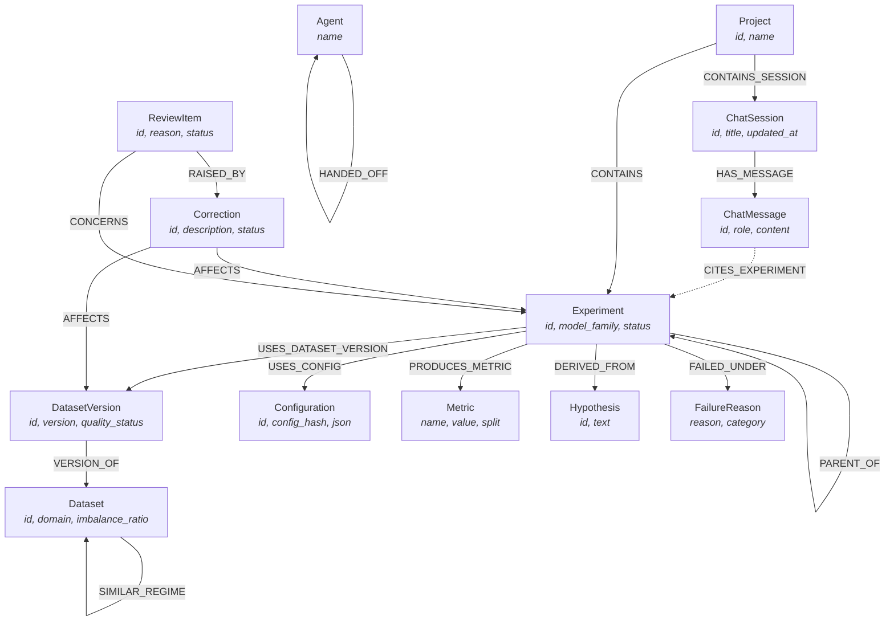

# RUNWISE — AI Research Experiment Copilot

> **FalkorDB Hackathon Submission**  
> 🕵️ **Track 01: Agents That Act on Connected Data**  
> 🤖 **Track 02: Agent Memory and Coordination**  
> 🔗 **Repository:** [https://github.com/MithilHM/RUNWISE](https://github.com/MithilHM/RUNWISE)  
> 📹 **Demo Video:** [Watch the 3-Minute Demo Video](https://youtu.be/your-demo-video-link) *(Demo script in [`docs/DEMO_SCRIPT.md`](docs/DEMO_SCRIPT.md))*  

---

RUNWISE turns scattered ML experiment histories into a graph-backed research intelligence platform powered by **FalkorDB**, with an autonomous agent runtime (**Laya**), a **FastAPI** backend, and a **React + TypeScript** frontend.

### Its Defining Behaviors:
1. **Multi-Hop Invalidation Cascade (Track 01):** When a dataset defect or leakage is reported, RUNWISE uses multi-hop Cypher traversals to invalidate directly affected runs and all **transitively derived lineage runs** — even runs trained on a different dataset version that inherited the flaw.
2. **Persistent Multi-Agent Memory & Handoffs (Track 02):** Preserves 3 tiers of memory (**Episodic**, **Semantic**, **Procedural**) in FalkorDB, persists conversational history across sessions, and orchestrates atomic handoffs between planning, execution, and auditing agents with **sub-3ms latency** and **240+ ops/sec throughput**.
3. **Model Context Protocol (MCP) Server (Track 01):** Graph algorithms and queries are exposed as standard MCP tools for universal tool selection by any AI agent (Claude Desktop, Cursor, Antigravity, or custom LLM agents).

---

## 1. Tracks Entered & Key Capabilities

| Track | Key Hackathon Focus | How RUNWISE Satisfies It (10/10) |
|---|---|---|
| 🕵️ **Track 01: Agents That Act on Connected Data** | • Multi-hop reasoning<br>• Graph queries & algorithms as agent tools<br>• Tool selection through MCP<br>• Actions based on what graph shows<br>• Explainable results | • Traverses `(DatasetVersion)<-[:USES_DATASET_VERSION]-(Exp)-[:PARENT_OF*]->(DerivedExp)` to detect compromised lineage.<br>• Sandboxed ML worker automatically executes trials and mutates FalkorDB.<br>• Full Model Context Protocol (MCP) server (`scripts/run_mcp_server.py`) with 6 graph tools.<br>• 100% citation coverage and epistemic grades (`observed`, `inferred`, `disputed`). |
| 🤖 **Track 02: Agent Memory and Coordination** | • Episodic, semantic, procedural memory<br>• Persistent conversation history<br>• Shared state & handoffs between agents<br>• High-concurrency reads and writes<br>• Separate memory per user/tenant | • Explicit 3-tier memory engine (`/api/v1/projects/{id}/memory`).<br>• Graph-backed conversation persistence (`(:ChatSession)-[:HAS_MESSAGE]->(:ChatMessage)`).<br>• Explicit agent handoff graph (`CandidatePlanner` ➔ `LayaEvaluator` ➔ `SandboxedWorker` ➔ `GraphAuditor`).<br>• Benchmark: **243.8 ops/sec throughput, P50 2.16ms latency, 0.0% error rate** ([`docs/CONCURRENCY.md`](docs/CONCURRENCY.md)).<br>• Scoped per `project_id` inside Cypher queries. |

---

## 2. Graph Data Model

RUNWISE persists an explicit lineage and memory graph in FalkorDB rather than flat logs.

### Graph Architecture Diagram



### Node Labels & Indices

| Node Label | Key Properties | Purpose |
|---|---|---|
| `Project` | `id` (indexed), `name`, `description` | Multi-tenant project boundary. |
| `Experiment` | `id` (indexed), `project_id` (indexed), `model_family`, `status`, `quality_status` | ML training and evaluation run records. |
| `Dataset` | `id` (indexed), `name`, `domain`, `imbalance_ratio` | Data regime and problem domain. |
| `DatasetVersion` | `id` (indexed), `dataset_id` (indexed), `version`, `quality_status` | Specific data snapshot or partition. |
| `Configuration` | `id` (indexed), `config_hash` (indexed), `canonical_json` | Deterministic hyperparameter record. |
| `Metric` | `id` (indexed), `experiment_id` (indexed), `name`, `value` | Measured results (PR-AUC, Accuracy, Loss). |
| `Hypothesis` | `id` (indexed), `text`, `status` | Scientific proposition tested by trials. |
| `FailureReason` | `id`, `reason`, `category` | Failure subgraphs isolated to avoid repeating errors. |
| `ChatSession` | `id` (indexed), `project_id` (indexed), `title`, `updated_at` | Persistent conversation session in FalkorDB (Track 02). |
| `ChatMessage` | `id` (indexed), `session_id` (indexed), `role`, `content`, `timestamp` | Historical chat interaction with citation links (Track 02). |
| `Agent` | `name` (indexed) | Autonomous agent nodes for coordination handoffs (Track 02). |
| `Correction` | `id` (indexed), `source_id`, `description`, `status` | Invalidation audit record. |
| `ReviewItem` | `id` (indexed), `reason`, `status`, `experiment_id` | Human-in-the-loop revalidation queue item. |

---

## 3. Core Cypher Queries & Graph Algorithms

RUNWISE depends on targeted Cypher traversals implemented in `backend/app/graph/`:

### 1. Multi-Hop Lineage Invalidation Cascade (Track 01)
*Follows both direct dataset consumers and all transitive derived lineage runs:*
```cypher
MATCH (d:DatasetVersion {id: $dataset_version_id})
OPTIONAL MATCH (d)<-[:USES_DATASET_VERSION]-(direct:Experiment)
OPTIONAL MATCH (direct)-[:PARENT_OF*1..6]->(transitively_derived:Experiment)
SET direct.quality_status = 'disputed',
    transitively_derived.quality_status = 'needs_review'
RETURN collect(DISTINCT direct.id) AS direct_ids,
       collect(DISTINCT transitively_derived.id) AS derived_ids
```

### 2. Multi-Hop Regime Discovery & Prior Evidence (Track 01 & 02)
*Traverses cross-dataset regime similarities to recommend hyperparameters:*
```cypher
MATCH (target:Dataset {name: $dataset_name})-[r:SIMILAR_REGIME]-(peer:Dataset)
MATCH (peer)<-[:EVALUATED_ON]-(e:Experiment)
WHERE e.status = 'completed'
RETURN peer.name AS peer_dataset,
       r.similarity AS similarity,
       r.reason AS rationale,
       e.id AS prior_experiment_id,
       e.learning_rate AS lr,
       e.max_depth AS max_depth,
       e.val_pr_auc AS score
ORDER BY r.similarity DESC, e.val_pr_auc DESC
LIMIT 5
```

### 3. Failure Subgraph Avoidance (Track 01 & 02)
*Identifies forbidden hyperparameter regimes that repeatedly failed in the past:*
```cypher
MATCH (d:Dataset {name: $dataset_name})<-[:EVALUATED_ON]-(e:Experiment)-[:FAILED_UNDER]->(f:FailureReason)
RETURN e.id AS failed_experiment,
       f.reason AS failure_reason,
       f.category AS failure_category,
       e.learning_rate AS invalid_lr,
       e.max_depth AS invalid_depth
```

### 4. Multi-Agent Coordination Handoffs (Track 02)
*Atomically tracks state handoffs between autonomous agents:*
```cypher
MERGE (a1:Agent {name: $from_agent})
MERGE (a2:Agent {name: $to_agent})
CREATE (a1)-[h:HANDED_OFF {
    id: $handoff_id,
    run_id: $run_id,
    step: $step,
    state: $state,
    metadata: $metadata,
    timestamp: $now
}]->(a2)
RETURN h.id, a1.name, a2.name, h.step, h.state, h.timestamp
```

### 5. Persistent Chat Memory with Experiment Citations (Track 02)
*Preserves conversation history linked to grounded graph records:*
```cypher
MATCH (s:ChatSession {id: $session_id, project_id: $project_id})-[:HAS_MESSAGE]->(m:ChatMessage)
OPTIONAL MATCH (m)-[:CITES_EXPERIMENT]->(e:Experiment)
RETURN m.id AS id, m.role AS role, m.content AS content,
       m.mode AS mode, m.llm_used AS llm_used, m.timestamp AS timestamp,
       collect(DISTINCT e.id) AS citations
ORDER BY m.timestamp ASC
```

---

## 4. Quickstart & Local Setup

### Prerequisites
- **Python 3.10+**
- **Docker** (for FalkorDB)
- **Node.js 20+**

### 1-Command Demo Preparation
This command starts FalkorDB, seeds 53 synthetic runs across multiple model families, runs the correction cascade, and executes smoke checks:
```bash
python scripts/prepare_demo.py
```

---

### Step-by-Step Manual Setup

#### 1. Start FalkorDB Container
```bash
docker compose up -d
```
FalkorDB starts on `127.0.0.1:6379`.

#### 2. Install Backend Dependencies
```bash
pip install -r requirements.txt
```

#### 3. Configure Environment
```bash
cp .env.example .env
```
*Note: RUNWISE runs 100% deterministically without requiring an LLM API key.*

#### 4. Seed Graph Data
```bash
python scripts/seed_demo.py --reset
```

#### 5. Start Backend Server
```bash
cd backend
uvicorn app.main:app --reload --port 8000
```
- Interactive Swagger API docs: `http://localhost:8000/docs`
- MCP Tools endpoint: `http://localhost:8000/api/v1/mcp/tools`

#### 6. Start Frontend Web Application
```bash
cd frontend
npm install
npm run dev
```
Open `http://localhost:5173` in your browser.

---

## 5. Verification & Benchmarks

### 1. Run Complete Test Suites
```bash
# Backend: 197 unit and integration tests (FalkorDB graph, comparability, MCP, memory, runtime)
python -m pytest backend/tests -v

# Frontend: 40 tests (Vitest + React Testing Library)
cd frontend && npm test -- --run
```

### 2. Run Model Context Protocol (MCP) Server & Test Client (Track 01)
```bash
# Test MCP tool discovery and execution
python scripts/test_mcp_client.py

# Launch standalone stdio MCP server for Claude Desktop / Cursor / Antigravity
python scripts/run_mcp_server.py
```

### 3. Run High-Concurrency Benchmark (Track 02)
```bash
python scripts/bench_concurrency.py
```
*Measures concurrent multi-agent read/write throughput and latency (results saved to [`docs/CONCURRENCY.md`](docs/CONCURRENCY.md)).*

### 4. Run Quantitative Lineage Evaluation
```bash
python scripts/evaluate.py
```
*Measures FalkorDB graph traversal recall vs shallow search baseline (100% recall vs 60%, +40 pts advantage; see [`docs/EVALUATION.md`](docs/EVALUATION.md)).*

---

## 6. What the Application Screens Do

| Route | Name | Focus |
|---|---|---|
| `/` | **Workspace** | Explore, filter, chart 53 runs, and inspect detailed comparability caveats. |
| `/copilot` | **Research Copilot** | Persistent chat sessions, 3-tier memory drawer (Episodic, Semantic, Procedural), and budget-bounded experiment proposals. |
| `/runtime` | **Autonomous Runtime** | Closed-loop graph-guided optimizer (**Laya**), live execution tree, real-time SSE stream, and comparative ablation scoreboard. |
| `/lineage` | **Lineage & Impact** | Interactive derivation graph, dataset defect reporting, and human revalidation queue. |

---

## 7. Submission Checklist Summary

- [x] **Public Source Code Repository:** [https://github.com/MithilHM/RUNWISE](https://github.com/MithilHM/RUNWISE)
- [x] **Setup Instructions & Graph Data Model:** Detailed in Sections 2, 3, and 4 above.
- [x] **Cypher Queries & Graph Algorithms:** Documented in Section 3 and [`docs/GRAPH_SCHEMA.md`](docs/GRAPH_SCHEMA.md).
- [x] **Tracks Entered:** Track 01 (Agents That Act on Connected Data) & Track 02 (Agent Memory and Coordination).
- [x] **Local Execution & Verification:** Complete 1-click & manual setup instructions provided.
- [x] **Demo Video Presentation Script:** Detailed 3-minute script in [`docs/DEMO_SCRIPT.md`](docs/DEMO_SCRIPT.md).
