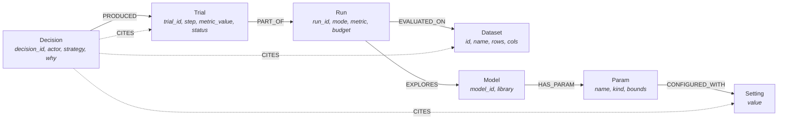

# RUNWISE — Autonomous ML Harness

> **An autonomous ML harness.** Drop in one static CSV. Pick from 3 models. Every hyperparameter, every trial, every decision, and every log line is a node in **FalkorDB**. The harness either runs itself or stops at every step and waits for you. Ask it *"why this model?"* and it answers in prose **and lights up the exact graph nodes that justify the answer**.

---

## 1. The Seven Features

| # | Feature | Description |
|---|---|---|
| **F1** | **Static CSV Intake** | Upload static tabular CSV, profile column datatypes, distributions, infer/confirm target column, and create stratified split. |
| **F2** | **Three Models** | `RandomForest`, `XGBoost`, and `LightGBM`, each exposing a complete, typed hyperparameter space (`ParamSpec`). |
| **F3** | **Hyperparameters Mapped to Graph** | Dynamic hyperparameter spaces mapped into FalkorDB — parameter settings and values recorded with structured citations. |
| **F4** | **Human Intervention or Autonomy** | Dual-mode state machine (`autonomous` or `human review`). Human mode stops at `AWAITING_REVIEW` after candidate proposals for researcher approval, override, or rejection. |
| **F5** | **Force-Directed Dependency Graph** | Left-to-right layered force-directed graph (`Dataset → Run → Model → Setting → Trial → Decision`), clickable, interactive, and shaded by metric. |
| **F6** | **Live Logs & Events** | Sequential log persistence with real-time Server-Sent Events (SSE) streaming and historical catch-up. |
| **F7** | **"Why the Model?" & Node Highlighting** | Transparent explainability records (`WhyRecord`) with prose justification, strategy, hypothesis, and bidirectional citation node highlighting. |

---

## 2. Graph Data Model

RUNWISE persists every trial, setting, and decision directly into **FalkorDB**:



### Node Labels
- `Dataset`: Profiling metrics, row/column counts, class balance, and task type.
- `Run`: State machine run metadata (`autonomous` vs `human`, budget, metric, status).
- `Model`: Supported algorithms (`xgboost`, `lightgbm`, `random_forest`).
- `Trial`: Concrete training executions with duration, hyperparameters, and metric outcomes.
- `Decision`: Laya or researcher decisions with strategy, hypothesis, prose justification, and citations.

---

## 3. Harness State Machine

The harness follows an explicit, guarded lifecycle:

```
IDLE → PROPOSING
PROPOSING ──autonomous──→ EXECUTING
PROPOSING ──human───────→ AWAITING_REVIEW ──approve────────────→ EXECUTING
                                        ──approve(edited)───→ EXECUTING
                                        ──reject────────────→ PROPOSING (step+1)
EXECUTING → MUTATING → PROPOSING (step+1)
PROPOSING ──step >= budget──→ COMPLETED
any state ──exception──→ FAILED
any state ──POST /pause──→ PAUSED ;  POST /resume──→ back to PROPOSING
```

- **Autonomous Mode:** Runs the requested trial budget end-to-end without blocking.
- **Human Review Mode:** Stops at `AWAITING_REVIEW` after proposing. Does not execute training until the researcher approves (with or without hyperparameter overrides) or rejects.

---

## 4. Model Context Protocol (MCP) Server

RUNWISE includes an MCP (Model Context Protocol) JSON-RPC 2.0 server (`/api/v1/mcp/rpc` and `/api/v1/mcp/tools`) providing standard graph tools for AI agents:

| Tool | Purpose |
|---|---|
| `list_models` | Lists the 3 models with their full parameter spaces (`ParamSpec`). |
| `list_datasets` | Lists ingested datasets and profiling summaries. |
| `list_trials` | Lists evaluated trials for a run, filterable by model or status. |
| `graph_neighbourhood` | Traverses N-hop subgraph topology around any node. |
| `explain_trial` | Retrieves the F7 explainability record with citations. |
| `best_trials` | Retrieves the trial leaderboard ranked in the correct metric direction. |

*Note: Free-form Cypher injection is strictly rejected to preserve security and graph integrity.*

---

## 5. API Reference

| Method | Path | Description | Returns |
|---|---|---|---|
| `GET` | `/health` | FalkorDB and app health check | `{status, app, database}` |
| `GET` | `/api/v1/catalog/models` | List models and parameter specifications | `{models: ModelSpec[], metrics: [...]}` |
| `POST` | `/api/v1/datasets` | Multipart upload and CSV profiling | `DatasetProfile` |
| `GET` | `/api/v1/datasets/{id}` | Get dataset profiling metadata | `DatasetProfile` |
| `POST` | `/api/v1/datasets/{id}/confirm-target` | Confirm or change target column | `DatasetProfile` |
| `GET` | `/api/v1/runs` | List all harness runs | `{runs: RunState[]}` |
| `POST` | `/api/v1/runs` | Create and launch harness run | `RunState` |
| `GET` | `/api/v1/runs/{id}` | Get run state with best trial | `RunState` |
| `POST` | `/api/v1/runs/{id}/pause` | Pause run after active trial | `RunState` |
| `POST` | `/api/v1/runs/{id}/resume` | Resume paused run | `RunState` |
| `GET` | `/api/v1/runs/{id}/pending` | Get proposal under human review | `{pending: Proposal \| null}` |
| `POST` | `/api/v1/runs/{id}/decide` | Submit human decision (`approve`/`reject`) | `RunState` |
| `GET` | `/api/v1/runs/{id}/why` | Retrieve F7 explainability record | `WhyRecord` |
| `GET` | `/api/v1/runs/{id}/logs` | Fetch sequential log entries | `{entries: LogEntry[]}` |
| `GET` | `/api/v1/runs/{id}/events` | Real-time Server-Sent Events (SSE) stream | `text/event-stream` |
| `GET` | `/api/v1/graph` | Force-directed graph snapshot | `GraphSnapshot` |

---

## 6. Running Locally

### 1. Start FalkorDB
```bash
docker compose up -d
```

### 2. Start the Backend API
```bash
pip install -r requirements.txt
uvicorn app.main:app --reload --port 8000
```
*API interactive documentation is available at `http://localhost:8000/docs`.*

To run in offline/fake mode without a FalkorDB container:
```bash
RUNWISE_FAKE=1 uvicorn app.main:app --port 8000
```

### 3. Start the Frontend Console
```bash
cd frontend
npm install
npm run dev
```
*Console opens at `http://localhost:5173`.*

---

## 7. Running the Test Suites

### Backend Tests (pytest)
```bash
python -m pytest backend/tests -q
```
Runs 210 unit and integration tests covering the harness state machine, API endpoints, FalkorDB queries, and MCP tools.

### Frontend Tests (vitest)
```bash
cd frontend
npm test -- --run
```
Runs 43 component tests covering parameter clamping, leaderboard ranking directions, evidence highlighting, and SSE log streaming.
